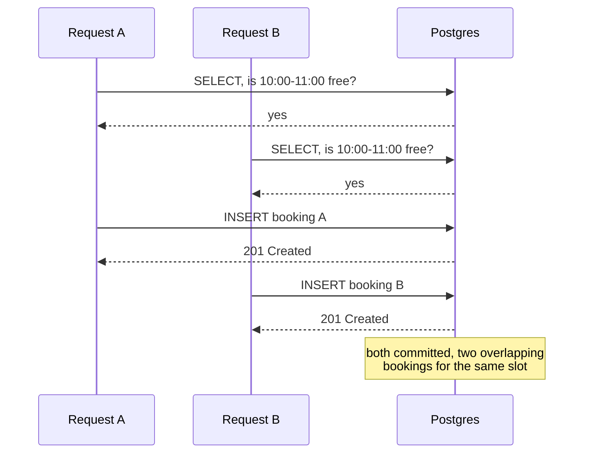
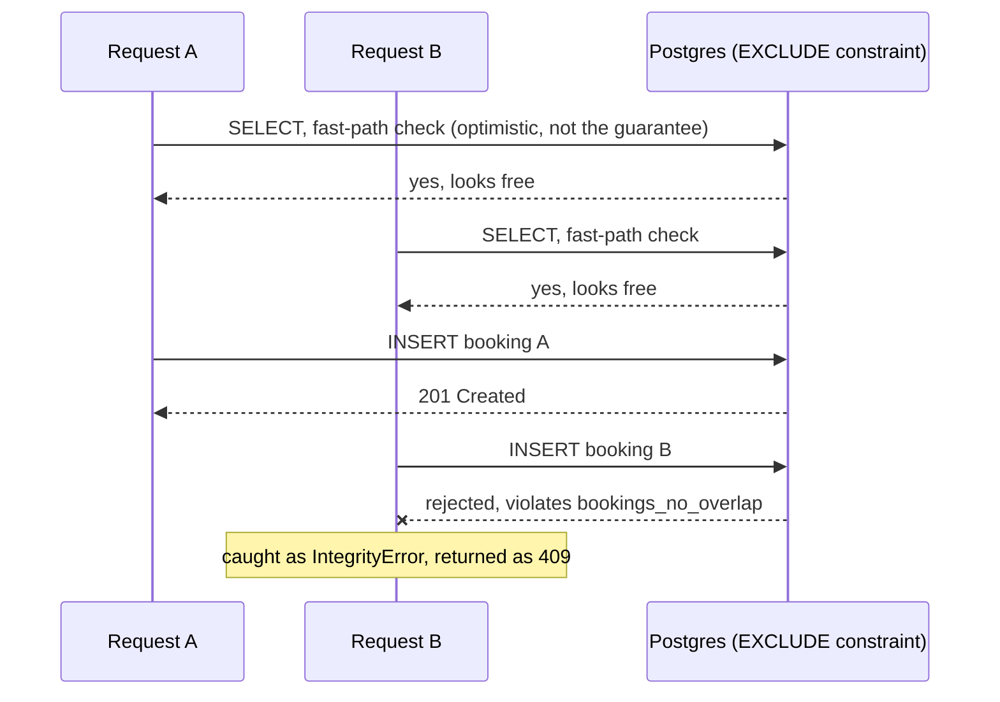
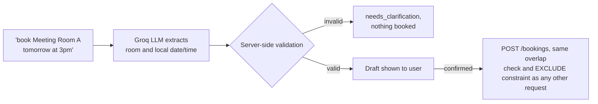
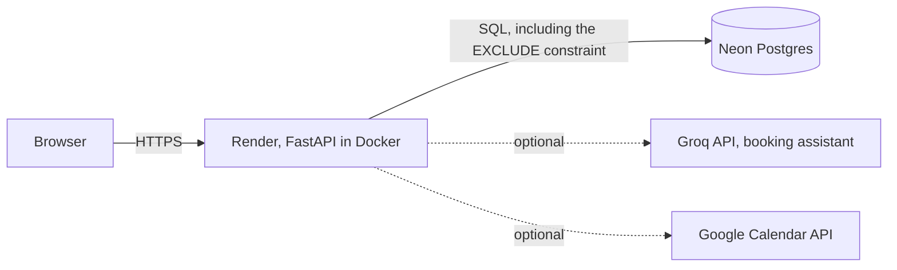

# RoomLock


Concurrency-safe room-booking API. I found a real double-booking race condition under load, fixed it two different ways, and load-tested both to see which one actually held up and which one was faster.

The app itself books study rooms and seminar spaces (themed, cosmetically, around FAU Erlangen-Nurnberg), but the interesting part is underneath: two concurrent requests for the same room and time slot, and making sure exactly one of them ever wins, under real contention, proven with numbers instead of assumptions.

**Live demo:** https://bookingapi-i4cg.onrender.com (free tier, first request after idle can take 30-50s to wake up)


## The race condition

The first version of the booking endpoint did the obvious thing: check if the slot is free, then insert the booking. That works fine for one request at a time. It breaks the moment two requests land close enough together, because nothing ties the check to the write. Both requests can see "free," and both can insert.



Running 30 concurrent users against the exact same slot for 10 seconds confirmed it wasn't theoretical: the naive endpoint landed **4 overlapping bookings (6 overlapping pairs)** in the database, verified by direct SQL query, not by trusting the HTTP responses.

## Two fixes, both verified, one faster

**Fix 1: a row lock.** `SELECT ... FOR UPDATE` on the resource row before the check, so a second transaction has to wait for the first to finish before it can even read. Correct, but the lock is on the whole resource row, not the specific timeslot, so it serializes every booking attempt on that resource, including ones that do not overlap at all.

**Fix 2: a Postgres exclusion constraint.** Instead of locking anything at the application level, `db/002_add_exclusion_constraint.sql` adds `EXCLUDE USING gist (resource_id WITH =, tstzrange(start_time, end_time) WITH &&)`. The app-level `SELECT` becomes just an optimistic fast path (cheap, saves a round trip in the common non-racing case), not the actual guarantee. If two concurrent requests both pass the `SELECT` and both `INSERT`, Postgres itself rejects the second insert at commit time, caught in code as an `IntegrityError` and turned into a 409. Non-overlapping bookings on the same resource can still commit concurrently, since the constraint only blocks genuine overlaps.



| | Fix 1: row lock (`FOR UPDATE`) | Fix 2: exclusion constraint |
|---|---|---|
| What's locked | The whole resource row | Nothing, at the app level |
| Where correctness lives | Application code | The database, at commit time |
| Non-overlapping bookings on the same resource | Also serialized | Commit concurrently |
| Result on a 30-user race for one slot | 1 succeeded, 4,127 correctly rejected, 0 overlaps | 1 succeeded, 4,447 correctly rejected, 0 overlaps |
| Throughput | 420 req/s | 452-570 req/s |

Same correctness both ways. Fix 2 wins on throughput because it stops punishing requests that were never actually in conflict. `tests/test_concurrency.py` automates the same check (20 concurrent identical requests, asserts exactly one wins) so it is proven on every CI run, not just a one-off manual test.

## Load test results

Reproduced with `scripts/fix_comparison_benchmark.py`, which checks out each version of `app/routers/bookings.py` into its own disposable `git worktree`, runs it in isolation, races 30 concurrent Locust users at the same slot, and verifies overlaps directly against Postgres before tearing the worktree down and moving to the next version.

| Version | Requests sent | Succeeded | Rejected (409) | Overlapping bookings found in DB | Throughput |
|---|---|---|---|---|---|
| Naive check-then-insert | (not exhaustively counted, failed fast) | multiple | 0 handled | 4 bookings, 6 overlapping pairs | n/a |
| Fix 1: `SELECT ... FOR UPDATE` row lock | 4,128 | 1 | 4,127 | 0 | 420 req/s |
| Fix 2: Postgres `EXCLUDE` constraint | 4,448 | 1 | 4,447 | 0 | 452-570 req/s |

That was 30 concurrent requests against one process. To check whether the same guarantee holds at real scale, `docker-compose.scale-demo.yml` stands up a throwaway stack (3 independent app containers behind nginx, sharing one Postgres) and `scripts/scale_benchmark.py` drives it:

**Same slot, maximum contention** (every request racing one exact slot, spread across all 3 replicas):

| Concurrent requests | Succeeded | Rejected (409) | Overlapping bookings | Wall time |
|---|---|---|---|---|
| 300 | 1 | 299 | 0 | 1.8s |
| 1,000 | 1 | 999 | 0 | 1.8s |
| 2,000 | 1 | 1,999 | 0 | 3.0s |
| 10,000 | 1 | 9,999 | 0 | 16.1s |

**Realistic mixed load** (10,000 requests: 9,800 targeting distinct slots that should all succeed, 200 deliberately aimed at an already-booked slot that should all correctly fail):

| | Count | Percent |
|---|---|---|
| Succeeded (201) | 9,800 | 98.00% |
| Correctly rejected (409) | 200 | 2.00% |
| Unexpected errors | 0 | 0.00% |

Every non-success was one of the 200 intentionally conflicting requests. The unexpected failure rate, which is the number that actually matters, was 0%. Sustained throughput across the 3-replica stack: **321 req/s**. Client-side latency: p50 55.8ms, p95 320ms, p99 2,120ms, max 3,871ms (round trip, including network and load-generator overhead; everything ran on one laptop sharing CPU cores with the system under test, so the tail latency here is noisier than a properly isolated benchmark would show, but the 0-overlap correctness numbers are unaffected by that).

`tests/test_failure_injection.py` separately proves the retry and idempotency machinery actually survives failure, not just the happy path: a transient deadlock recovers and still returns 201, exhausted retries return 503 (never a 500 or a hang) with zero partial rows, an idempotent resubmission returns the same booking after retrying through a simulated deadlock, and a hard-killed connection mid-transaction leaves no partial row at all, which is Postgres's own atomicity guarantee at work, independent of any application code.

`benchmark_results/` is where `scripts/run_scale_benchmark.sh` writes a fresh run's output; it is empty in this checkout since the numbers above are reported directly for readability, but running the script regenerates it.

## What actually broke building this

A load test that passes on the first try either got lucky or was not pushed hard enough. These were real failures hit while building the scale demo, not hypotheticals:

| Symptom | Root cause | Fix |
|---|---|---|
| Connections reset under load | nginx defaulted to HTTP/1.0 with no keepalive to the upstream, a fresh TCP connection per request | `proxy_http_version 1.1` plus `proxy_set_header Connection ""` and an upstream `keepalive` |
| Client-side timeouts waiting on a response | SQLAlchemy's unconfigured default pool (5 + 10 overflow per process) was undersized for the concurrent load | Explicit `pool_size`/`max_overflow`, sized against Postgres's `max_connections` |
| "no live upstreams," nginx briefly refused everything | nginx's default passive health check (`max_fails=1`) pulled all 3 replicas out of rotation after one transient blip each | `max_fails=5 fail_timeout=3s`, tolerate a few failures before pulling a replica |
| 62% of a realistic-load run came back 502 or 500 | FastAPI dispatches sync routes through a bounded thread pool (about 40 threads) per process, one process per container was not enough concurrency | `WEB_CONCURRENCY` (uvicorn `--workers`), tunable per deployment |

None of these were Postgres or the booking logic failing. All four were infrastructure capacity or configuration between the load generator and the database, which is exactly what a load test is supposed to surface.

## Tech stack

| Layer | Technology |
|---|---|
| API framework | FastAPI (Python 3.12) |
| Database | PostgreSQL 16, exclusion constraint via `btree_gist` |
| ORM | SQLAlchemy |
| Auth | JWT (python-jose), bcrypt password hashing, optional Google OAuth |
| Concurrency control | `SELECT ... FOR UPDATE` (fix 1), Postgres `EXCLUDE` constraint (fix 2), `pg_advisory_xact_lock` for idempotency keys |
| Load testing | Locust |
| Testing | pytest against a real throwaway Postgres instance, 158 tests, 97% coverage |
| Observability | Prometheus metrics, structured JSON access logs |
| CI | GitHub Actions: ruff, mypy, pytest with coverage against a Postgres 16 service container |
| Deployment | Docker, Render (app), Neon (serverless Postgres) |
| Extras | Natural-language booking assistant (Groq, `openai/gpt-oss-120b`), Google Calendar sync, iCal feed, recurring bookings, admin analytics |

## Running it locally

```bash
docker compose up --build
```

Apply the schema (not auto-run, run manually so each migration is explicit):

```bash
for f in db/*.sql; do
  echo "Applying $f..."
  docker compose exec db psql -U app -d bookingapi -f "/db/$(basename "$f")"
done
```

Generate real secrets before first run (the checked-in `.env` placeholders are dev-only):

```bash
python3 -c "import secrets; print(secrets.token_urlsafe(48))"        # JWT_SECRET_KEY
python3 -c "import base64,os; print(base64.urlsafe_b64encode(os.urandom(32)).decode())"  # TOKEN_ENCRYPTION_KEY
```

Check it's running:

```bash
curl http://localhost:8000/health
open http://localhost:8000/docs
```

Note: Postgres is exposed on host port 5434 (not 5432), since a native Postgres was already using 5432 and 5433 on the machine this was built on. `docker compose exec` commands go straight into the container and are unaffected.

A calendar UI is served at `http://localhost:8000/ui/` (`/ui/admin.html` for admins): register, log in, pick a resource and date, click an hourly slot, or type what you want into the "Or just describe it" box.

### Reproducing the race condition and the two fixes

`scripts/fix_comparison_benchmark.py` reproduces all three rows from the load test table above in one run. It checks out each commit into its own disposable git worktree, builds and runs it in isolation, races 30 concurrent requests at the same slot with Locust, and verifies overlaps directly against Postgres before tearing the worktree down:

```bash
pip install locust  # not a project dependency, only this manual benchmark needs it
python3 scripts/fix_comparison_benchmark.py
```

To race a single version by hand (whatever is currently checked out):

```bash
TEST_EMAIL=test@example.com TEST_PASSWORD=test-password-123 RESOURCE_ID=1 \
  locust -f loadtest/locustfile.py --headless -u 30 -r 30 -t 10s \
  --host http://localhost:8000
```

Then check for overlapping bookings (the verification query lives at the bottom of `db/001_schema.sql`):

```bash
docker compose exec db psql -U app -d bookingapi
```

### Reproducing the 3-replica scale test

```bash
./scripts/run_scale_benchmark.sh
```

This brings up `docker-compose.scale-demo.yml` (3 app containers behind nginx, one shared Postgres), applies migrations, runs every table from the "load test results" section above via `scripts/scale_benchmark.py`, writes results to `benchmark_results/`, and tears the stack down afterward.

### Running the test suite

```bash
docker compose exec api pytest -v
```

Runs against a throwaway `bookingapi_test` database in the same Postgres container, recreated each run with all `db/*.sql` migrations applied. Not SQLite: the whole point of `test_concurrency.py` is to prove the actual `EXCLUDE` constraint and advisory-lock behavior, which a non-Postgres test double cannot exercise. 158 tests, covering auth, resources, bookings, booking edits, recurring bookings, admin, the booking assistant (Groq call mocked), Google Calendar OAuth/sync (mocked), and encryption at rest.

```bash
pip install -r requirements-dev.txt
ruff check .
mypy app
pytest --cov=app --cov-report=term-missing --cov-report=xml
```

## Everything else built on top

- JWT auth plus optional "Sign in with Google" with calendar sync
- Idempotency keys: resubmitting the same key returns the original booking instead of erroring or duplicating, using `pg_advisory_xact_lock` scoped to `(user_id, idempotency_key)` to handle true duplicate submissions separately from the overlap check
- Role-based admin, bootstrapped via direct SQL (no self-promotion endpoint, by design)
- Booking editing, with the exclusion constraint enforced on `UPDATE` the same way it is on `INSERT`
- Room metadata (capacity, amenities), CSV bulk import, admin usage analytics
- Recurring weekly bookings with partial success if some weeks are already taken
- Dark mode, installable PWA
- Natural-language booking assistant ("book Meeting Room A tomorrow at 3pm") parsed by an LLM into a draft the user must confirm. Every field is re-validated against the real resource list and clock, and the draft still goes through the same `POST /bookings` path as any manually typed request, so the model never has a way to book anything directly
- Per-user iCal subscription feed, no OAuth required
- Prometheus metrics and structured JSON access logs on every request

<details>
<summary><strong>Google Calendar sync setup</strong> (optional)</summary>

When connected, every booking is silently synced to the user's Google Calendar and un-synced on cancel. Any Google API failure is caught and ignored on purpose, since it must never affect whether a booking succeeds or cancels.

1. In [Google Cloud Console](https://console.cloud.google.com/), create or select a project.
2. Enable the Google Calendar API under APIs & Services, Library.
3. Under OAuth consent screen, choose External, fill in the required fields, and add your own Google account as a test user while in "Testing" mode.
4. Under Credentials, create an OAuth client ID of type Web application, with a redirect URI matching `GOOGLE_REDIRECT_URI` exactly (`http://localhost:8000/auth/google/callback` for local dev).
5. Add the client ID and secret to `.env`:
   ```bash
   GOOGLE_CLIENT_ID=...
   GOOGLE_CLIENT_SECRET=...
   ```
6. Restart the API: `docker compose up --build -d api`.

Leaving the Google env vars blank disables the integration cleanly (503, surfaced as a toast rather than a broken redirect).

</details>

<details>
<summary><strong>Natural-language booking assistant setup</strong> (optional)</summary>

Free tier, no credit card required.

1. Get an API key at [console.groq.com/keys](https://console.groq.com/keys).
2. Add it to `.env`:
   ```bash
   GROQ_API_KEY=...
   ```
3. Restart the API. The "Or just describe it" box appears automatically once a key is configured.

The model (`openai/gpt-oss-120b`, served by Groq) is only asked to extract local wall-clock date and time plus a resource name from free text. Timezone conversion and default-duration math are done in Python, not trusted to the model (`app/groq_client.py` has comments on the two real bugs that motivated that split: the model got DST-aware UTC conversion wrong by an hour, and separately left a default duration unset). Every field is re-validated server-side, and the actual booking write still goes through the normal `POST /bookings` path.



</details>

## Deployment

Live at https://bookingapi-i4cg.onrender.com, free tier throughout: Render (Docker web service built from this repo's `Dockerfile`) and Neon (serverless Postgres, with `btree_gist` enabled for the exclusion constraint).



Render's free web service sleeps after 15 minutes idle, so the first request after a quiet period takes 30-50s to wake up.

## Security notes

- Rate limited: `/auth/login` (10/min) and `/auth/register` (5/min) per IP via `slowapi`. The booking assistant is separately rate-limited (10/min) since each call costs a real API request.
- Passwords are bcrypt-hashed, never stored or logged in plaintext, minimum 8 characters enforced at the schema level.
- Google refresh tokens are encrypted at rest (Fernet), so a database leak alone does not hand out live Calendar access.
- LLM output is never trusted directly. Every field the assistant returns is re-validated against the real database and clock, and the booking write itself is unreachable from the model, only from a user-confirmed draft going through the normal endpoint.
- Known gaps: no email verification on registration, and auth tokens live in `localStorage` rather than an httpOnly cookie (a standard tradeoff for a Bearer-token API, acceptable as long as there is no way to inject arbitrary script, which the app avoids by never rendering user-supplied strings via `innerHTML`).

**Independent student project, not an official FAU service, and not affiliated with or endorsed by the university.** The FAU-blue color scheme and sample room names are cosmetic branding on top of a generic booking backend not tied to any one institution.
