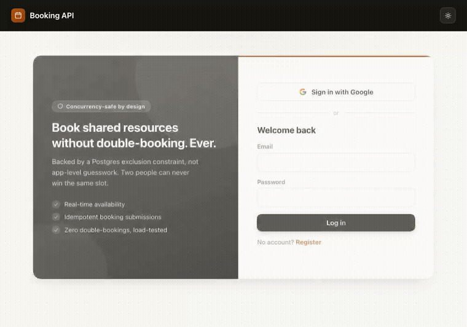
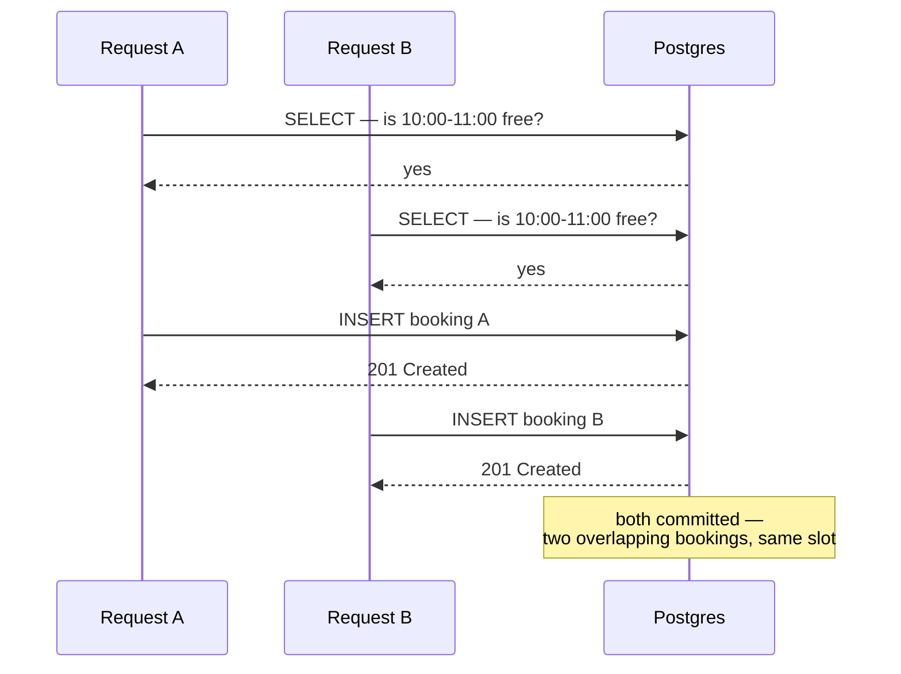
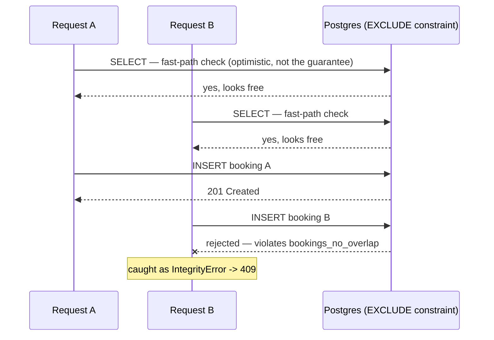
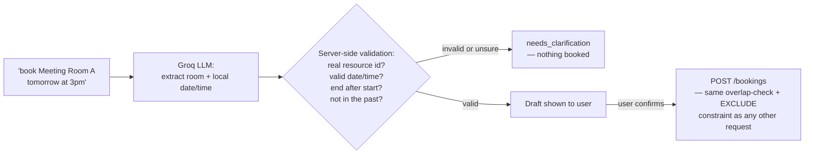
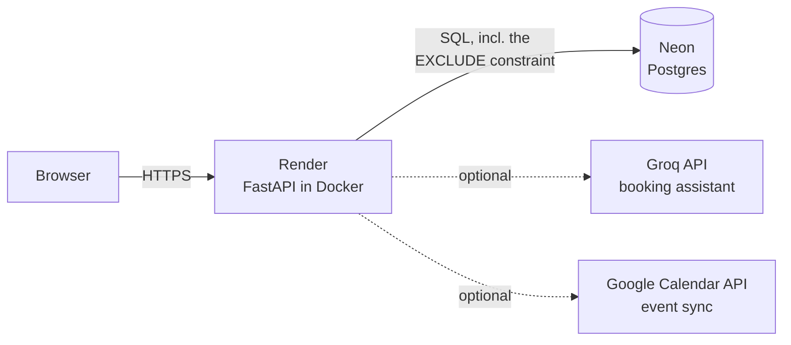

# booking-api

Concurrency-safe resource booking API: found a double-booking race under
load, fixed it two different ways (row lock, then a Postgres exclusion
constraint), load-tested both to compare correctness and throughput, and
then kept building — room metadata, recurring bookings, admin analytics,
and a natural-language booking assistant on top of it.

**Live demo:** **https://bookingapi-i4cg.onrender.com**
(free-tier hosting — if it's been quiet for a while, the first request can
take 30-50s to wake up. Everything after that is normal speed.)



## The core story: a real race condition, fixed twice, measured both times

Two requests can both `SELECT` "is this slot free?", both get "yes," and
both `INSERT` — nothing ties the check to the write:



The fix isn't a bigger check — it's removing the gap between checking and
writing entirely, by giving Postgres itself a constraint it enforces at
commit time regardless of what any `SELECT` saw beforehand:



Racing 30 concurrent users at the exact same slot for 10 seconds, against
each version:

| Version | Requests | Succeeded | Rejected (409) | Overlapping bookings in DB | Throughput |
|---|---|---|---|---|---|
| Naive check-then-insert | — | multiple | — | **4 bookings, 6 overlapping pairs** | — |
| Fix 1: `SELECT ... FOR UPDATE` row lock | 4,128 | 1 | 4,127 | 0 | 420 req/s |
| Fix 2: Postgres `EXCLUDE` constraint | 4,448 | 1 | 4,447 | 0 | 452-570 req/s |

Fix 1 works, but the lock is on the *resource row*, not the *timeslot* — it
serializes every booking attempt on that resource, including ones that
don't overlap at all. Fix 2 (`db/002_add_exclusion_constraint.sql`) lets
Postgres reject only genuinely overlapping rows at commit time via
`EXCLUDE USING gist (resource_id WITH =, tstzrange(start_time, end_time)
WITH &&)`, so non-overlapping bookings on the same resource commit
concurrently — same correctness, higher throughput, no app-level lock.
`tests/test_concurrency.py` automates the same check (20 concurrent
identical requests, asserts exactly one wins) so it's proven on every test
run, not just the one manual load test.

## Everything else, in the order it was built

- **Auth**: JWT (python-jose) + bcrypt password hashing, plus optional
  "Sign in with Google" / calendar sync.
- **Idempotency keys**: resubmitting a booking with the same key returns
  the original instead of erroring or duplicating — `pg_advisory_xact_lock`
  scoped to `(user_id, idempotency_key)` handles true duplicate submissions
  racing each other, separately from the overlap-check machinery above.
- **Role-based admin**: `is_admin` gate on room management and user roles,
  bootstrapped via direct SQL (no self-promotion endpoint, by design).
- **Automated tests**: pytest against a real throwaway Postgres database
  (not SQLite — the whole point is Postgres-specific guarantees a mock
  can't exercise), including the concurrency test above.
- **Booking editing**: change the time on an existing booking; Postgres
  checks the exclusion constraint on `UPDATE` the same way it does on
  `INSERT`.
- **Room metadata**: capacity, amenities.
- **CSV bulk-import**: admins add many rooms at once instead of one-by-one.
- **Admin analytics**: usage stats, busiest rooms/hours.
- **Recurring bookings**: weekly series, partial success if some weeks are
  taken, cancel-one or cancel-the-series.
- **Dark mode + installable PWA**: persists across pages, offline-capable
  app shell.
- **Natural-language booking assistant**: "book Meeting Room A tomorrow at
  3pm" gets parsed by an LLM (GPT OSS 120B via Groq's free tier) into a
  structured draft — but the model never books anything directly. Every
  field is re-validated against the real resource list and clock, and the
  draft still goes through the exact same `POST /bookings` overlap-check +
  exclusion-constraint path as any other request. Two real bugs were found
  building this: the model got DST-aware UTC conversion wrong by an hour,
  and separately left a default duration unset — both fixed by doing that
  arithmetic in code instead of trusting the model with it (see
  `app/groq_client.py`).

## Setup

```bash
docker compose up --build
```

Then apply the schema manually (not auto-run via `Base.metadata.create_all()`):

```bash
for f in db/*.sql; do
  echo "Applying $f..."
  docker compose exec db psql -U app -d bookingapi -f "/db/$(basename "$f")"
done
```

Before first run, generate real secrets for `.env` (the checked-in placeholders are dev-only and must not be used anywhere reachable by anyone else):

```bash
python3 -c "import secrets; print(secrets.token_urlsafe(48))"        # -> JWT_SECRET_KEY
python3 -c "import base64,os; print(base64.urlsafe_b64encode(os.urandom(32)).decode())"  # -> TOKEN_ENCRYPTION_KEY
```

Check it's up:

```bash
curl http://localhost:8000/health
open http://localhost:8000/docs
```

Note: Postgres is exposed on host port **5434** (not 5432), since a native
Postgres was already using 5432 (and 5433) on this machine. `docker compose
exec` commands above go straight into the container and are unaffected.

## Calendar UI

A calendar app is served at `http://localhost:8000/ui/` (`/ui/admin.html`
for admins) — register/log in, pick a resource and date, and click an
hourly slot to book it, or just type what you want into the "Or just
describe it" box. A "Resend last booking" button re-submits the same
request (same idempotency key) to demonstrate that a retry returns the
original booking instead of erroring or double-booking.

## Auth flow

```bash
# Register
curl -X POST http://localhost:8000/auth/register \
  -H "Content-Type: application/json" \
  -d '{"email": "test@example.com", "password": "test-password-123"}'

# Login (OAuth2 password flow — form-encoded, not JSON)
curl -X POST http://localhost:8000/auth/login \
  -d "username=test@example.com&password=test-password-123"
# -> {"access_token": "...", "token_type": "bearer"}
```

## Admin access

Creating/deleting rooms (`POST`/`DELETE /resources`) and promoting other
users requires `is_admin`, which defaults to `false` for everyone — nobody
is an admin until someone makes them one. Bootstrap the first admin
directly in the database (there's no other way in, by design — an API
endpoint that could self-promote would defeat the point):

```bash
docker compose exec db psql -U app -d bookingapi \
  -c "UPDATE users SET is_admin = true WHERE email = 'you@example.com';"
```

From there, that account can promote/demote anyone else, manage rooms
(including CSV bulk-import), and view usage analytics from
`/ui/admin.html` (linked in the header once logged in as an admin) — no
more manual SQL needed. The API refuses to demote the last remaining admin.

## Create a resource and a booking

```bash
TOKEN="<access_token from an admin account>"

curl -X POST http://localhost:8000/resources \
  -H "Authorization: Bearer $TOKEN" \
  -H "Content-Type: application/json" \
  -d '{"name": "Meeting Room A", "capacity": 8, "amenities": ["Projector", "Whiteboard"]}'
# -> {"id": 1, ...}

TOKEN="<access_token from any account>"
curl -X POST http://localhost:8000/bookings \
  -H "Authorization: Bearer $TOKEN" \
  -H "Content-Type: application/json" \
  -d '{"resource_id": 1, "start_time": "2026-09-01T10:00:00Z", "end_time": "2026-09-01T11:00:00Z", "idempotency_key": "<client-generated-uuid>"}'
# idempotency_key is optional. Resubmitting the same key returns the
# original booking instead of erroring or creating a duplicate.

curl "http://localhost:8000/bookings?resource_id=1&date=2026-09-01" \
  -H "Authorization: Bearer $TOKEN"
```

Or skip the manual JSON entirely:

```bash
curl -X POST http://localhost:8000/assistant/parse \
  -H "Authorization: Bearer $TOKEN" \
  -H "Content-Type: application/json" \
  -d '{"message": "book Meeting Room A next Tuesday at 2pm"}'
# -> a draft {resource_id, start_time, end_time} for the frontend to
#    confirm before it hits POST /bookings above
```

## Recurring bookings

```bash
curl -X POST http://localhost:8000/bookings/recurring \
  -H "Authorization: Bearer $TOKEN" \
  -H "Content-Type: application/json" \
  -d '{"resource_id": 1, "start_time": "2026-09-01T10:00:00Z", "end_time": "2026-09-01T11:00:00Z", "occurrences": 6}'
# books 6 weekly occurrences starting from start_time; a slot that's
# already taken in a given week is reported back as "skipped" rather than
# aborting the whole series

curl -X DELETE "http://localhost:8000/bookings/series/<series_id>" \
  -H "Authorization: Bearer $TOKEN"
# cancels this and all future occurrences in the series
```

## Running tests

```bash
docker compose exec api pytest -v
```

Runs against a throwaway `bookingapi_test` database in the same Postgres
container (dropped and recreated each run, with all `db/*.sql` migrations
applied) — not SQLite, since the whole point of `test_concurrency.py` is to
prove the actual `EXCLUDE` constraint and advisory-lock behavior work, which
a non-Postgres test double couldn't exercise. That file races 20 concurrent
identical requests at the same slot and asserts exactly one wins, zero
overlaps land in the database — the automated version of the manual Locust
load test below. 66 tests total, covering auth, resources, bookings,
booking edits, recurring bookings, admin, and the booking assistant
(with the Groq call mocked so tests don't depend on network/API cost).

## Load test (reproducing the race condition)

```bash
pip install locust
TEST_EMAIL=test@example.com TEST_PASSWORD=test-password-123 RESOURCE_ID=1 \
  locust -f loadtest/locustfile.py --headless -u 30 -r 30 -t 10s \
  --host http://localhost:8000
```

Then check for overlapping bookings — the verification query lives at the
bottom of `db/001_schema.sql`:

```bash
docker compose exec db psql -U app -d bookingapi
```

<details>
<summary><strong>Google Calendar sync</strong> (optional — click to expand setup)</summary>

When connected, every booking is silently synced to the user's Google
Calendar (and un-synced on cancel), so Google's own reminder system
handles notifying them — no email infra of our own. It's entirely
best-effort: any Google API failure is caught and logged nowhere, on
purpose, since it must never affect whether a booking succeeds/cancels.

Two ways to connect, same underlying OAuth setup:
- **"Sign in with Google"** on the login screen — for a new visitor, this
  authenticates them (creating an account if their Google email isn't
  registered yet, password field left empty) *and* connects calendar sync
  in one consent screen.
- **"Connect Google Calendar"** in the app sidebar — for a user who's
  already logged in (password or Google) and just wants to add calendar
  sync without changing how they log in.

To enable either:

1. In [Google Cloud Console](https://console.cloud.google.com/), create a
   project (or use an existing one).
2. **APIs & Services > Library** — enable the **Google Calendar API**.
3. **APIs & Services > OAuth consent screen** — choose **External**,
   fill in the required fields (app name, your email). While in "Testing"
   mode you'll need to add your own Google account under **Test users** —
   only those accounts can complete the consent flow until the app is
   published/verified, which isn't needed for personal/small-group use.
4. **APIs & Services > Credentials > Create Credentials > OAuth client ID**
   — type **Web application**. Add an authorized redirect URI matching
   `GOOGLE_REDIRECT_URI` below exactly (`http://localhost:8000/auth/google/callback`
   for local dev; update this — and re-add it here — when you deploy).
5. Copy the generated **Client ID** and **Client secret** into `.env`:
   ```bash
   GOOGLE_CLIENT_ID=...
   GOOGLE_CLIENT_SECRET=...
   ```
6. Restart the API (`docker compose up --build -d api`) — both "Sign in
   with Google" and "Connect Google Calendar" work from there.

Leaving `GOOGLE_CLIENT_ID`/`GOOGLE_CLIENT_SECRET` blank disables the
integration cleanly — `/auth/google/login` and `/auth/google/connect` both
return 503, surfaced in the UI as a toast rather than a broken redirect.

</details>

<details>
<summary><strong>Natural-language booking assistant</strong> (optional — click to expand setup)</summary>

Free tier, no credit card required:

1. Go to [console.groq.com/keys](https://console.groq.com/keys), sign in,
   create an API key.
2. Add it to `.env`:
   ```bash
   GROQ_API_KEY=...
   ```
3. Restart the API. The "Or just describe it" box appears on the booking
   page automatically once a key is configured (`GET /assistant/status`
   drives that check) — leaving it blank disables the feature cleanly,
   same pattern as the Google integration above.

The model (`openai/gpt-oss-120b`, open-weight, served by Groq — originally
Llama 3.3 70B until Groq decommissioned it) is only ever asked to extract
*local wall-clock* date/time and match a resource name from free text.
Timezone conversion and default-duration math are done in Python
(`app/groq_client.py`, `app/routers/assistant.py`), not trusted to the
model — see the comments there for the two real bugs that motivated that
split. Every field is re-validated server-side before it's ever shown to
the user as a draft, and the draft still has to go through the same
`POST /bookings` guarantee as any other booking:



The model never has a path to write a booking directly — confirming a
draft is just a normal `POST /bookings` call, indistinguishable from one
typed in by hand.

</details>

## Deployment

Live at **https://bookingapi-i4cg.onrender.com** — free tier throughout:
- **App**: [Render](https://render.com), Docker web service built straight
  from this repo's `Dockerfile`.
- **Database**: [Neon](https://neon.tech), serverless Postgres (`btree_gist`
  extension enabled for the exclusion constraint).



Free-tier tradeoff: Render's free web service sleeps after 15 minutes
idle, so the first request after a quiet period takes 30-50s to wake up —
fine for sharing with a small group, not for anything latency-sensitive.

## Security notes

- **Rate limited**: `/auth/login` (10/min) and `/auth/register` (5/min) per
  IP, via `slowapi` — see `app/rate_limit.py`. The booking assistant is
  separately rate-limited (10/min) since each call costs a real API request.
- **Passwords**: bcrypt-hashed (never stored/logged in plaintext), minimum
  8 characters enforced at the schema level (`app/schemas.py`).
- **Google refresh tokens**: encrypted at rest (Fernet, `app/crypto.py`) —
  a database leak alone doesn't hand out live Calendar access. Requires
  `TOKEN_ENCRYPTION_KEY` to be set; if it changes, previously-connected
  users' tokens become undecryptable and they'll need to reconnect.
- **JWT secret**: must be a real random value in any environment other
  users can reach.
- **LLM output is never trusted directly**: every field the booking
  assistant returns (resource id, date, time) is re-validated against the
  real database and clock before being shown to the user, and the actual
  booking write is unreachable from the model — it can only produce a
  draft the user must explicitly confirm through the normal endpoint.
- Known gaps, if this goes further: no email verification on registration
  (anyone can register with any email address without proving they own it),
  and auth tokens live in `localStorage` rather than an httpOnly cookie
  (standard XSS-vs-CSRF tradeoff for a Bearer-token API; fine as long as
  there's no way to inject arbitrary script, which the app avoids by never
  rendering user-supplied strings via `innerHTML`).
